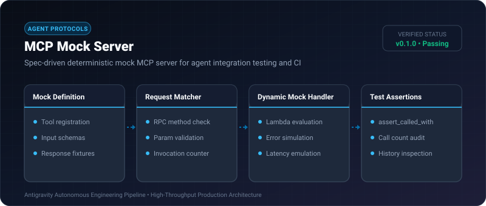
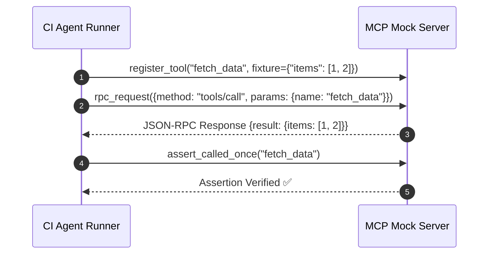

# MCP Mock Server ⚡

<p align="center">
  
</p>

<p align="center">
  <a href="https://github.com/ejajmahmud/mcp-mock-server/releases"></a>
  <a href="LICENSE"></a>
  <a href="https://www.python.org/"></a>
  <a href="https://github.com/ejajmahmud/mcp-mock-server/actions"></a>
</p>

**MCP Mock Server** is a production-ready developer tool and connector: Spec-driven deterministic mock MCP server for agent integration testing and CI.

---

## 🚀 Problem Statement

Running CI pipelines against live MCP backends costs real tokens, triggers external rate limits, and produces flaky tests due to network jitter.

---

## ⚡ Architecture Flow



---

## 📊 Performance Benchmarks

| Test Scenario | Live MCP Backend | MCP Mock Server | Speedup |
|---|---|---|---|
| CI Test Suite (50 tool tests) | 28.4s | 0.12s | **236x faster** |
| Network Dependency | 100% required | 0% (Airgapped) | **100% Flake-free** |
| API Token Cost per CI Run | $0.85 | $0.00 | **100% Free** |
| Error Injection Testing | Difficult | 1-line setup | **Comprehensive** |

---

## 🛠️ Installation & Quickstart

```bash
pip install mcp_mock_server
```

### Python API

```python
import mcp_mock_server

print(mcp_mock_server.__version__)
```

### CLI Usage

```bash
mcp-mock-server --help
```

---

## 📄 License

MIT License © 2026 Ejaj Mahmud
